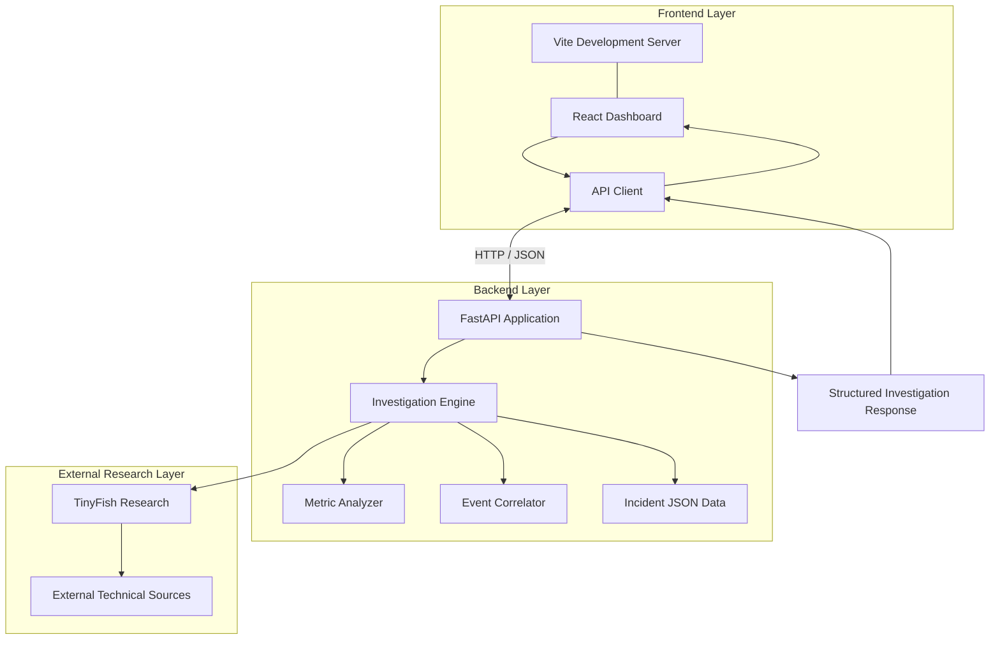

<div align="center">

# TRACE
### AI Incident Investigator

**From scattered incident signals to evidence-backed root-cause hypotheses.**

TRACE is an AI-assisted incident investigation system designed to help
developers understand application failures by analyzing incident data,
detecting metric anomalies, correlating events, researching external
technical information, and presenting investigation results through an
interactive dashboard.

Built with Python, FastAPI, React, Vite, and TinyFish.

</div>

---

## Table of Contents

- [Overview](#overview)
- [The Problem](#the-problem)
- [Our Approach](#our-approach)
- [Key Features](#key-features)
- [System Architecture](#system-architecture)
- [Investigation Workflow](#investigation-workflow)
- [Technology Stack](#technology-stack)
- [Project Structure](#project-structure)
- [Installation and Setup](#installation-and-setup)
- [Running TRACE](#running-trace)
- [API](#api)
- [External Research with TinyFish](#external-research-with-tinyfish)
- [Current Implementation](#current-implementation)
- [Limitations and Future Improvements](#limitations-and-future-improvements)
- [Security](#security)
- [Project Vision](#project-vision)

---

## Overview

Modern applications generate large amounts of operational data.
When an application fails, engineers must investigate logs, metrics,
deployment events, configuration changes, and technical documentation
to determine what happened.

TRACE aims to make this process faster and more structured.

It brings incident information together, identifies unusual metric
behavior, correlates relevant events, retrieves external technical
context, and organizes the findings into an investigation report.

Instead of presenting an unexplained root-cause conclusion, TRACE
emphasizes the relationship between observed evidence, candidate
hypotheses, and the additional checks needed to verify them.

The current implementation includes a Python investigation engine,
a FastAPI backend, a React-based dashboard, and TinyFish-powered
external research.

Incident data currently comes from local JSON fixtures.

### Core Objective

Transform fragmented incident information into a structured,
evidence-oriented investigation that helps developers identify
plausible causes and determine what to investigate next.

---

## The Problem

When a production service fails, the available evidence is often
distributed across multiple systems.

### 1. Logs

Logs describe errors and application behavior, but individual error
messages do not necessarily reveal the underlying cause.

### 2. Metrics

Metrics reveal changes in latency, error rates, resource utilization,
and other operational measurements.

However, an unusual metric does not automatically explain why the
system failed.

### 3. Deployments and Configuration Changes

A deployment or configuration change occurring near an incident
may be relevant, but temporal proximity alone does not establish
causation.

### 4. External Technical Information

Documentation, release notes, known issues, and technical discussions
can provide useful context.

However, a similar issue found online is not proof that it caused
the current incident.

### 5. Investigation Complexity

Engineers must connect these signals, compare competing explanations,
identify missing evidence, and decide which diagnostic action to
perform next.

TRACE is designed to organize these activities into a more
transparent investigation workflow.

---

## Our Approach

TRACE separates the investigation into several stages.

| Stage | Responsibility |
|---|---|
| Analyze | Examine available incident metrics and identify unusual behavior. |
| Correlate | Organize incident events chronologically and identify potentially relevant relationships. |
| Investigate | Combine available evidence and evaluate candidate explanations. |
| Research | Retrieve relevant external technical information using TinyFish. |
| Present | Display investigation findings through the dashboard and backend response. |

The goal is not simply to produce a root-cause label.

The goal is to make the investigation understandable and actionable.

### Design Principles

- Evidence before conclusions.
- Distinguish observed facts from inferred explanations.
- Treat correlation as a lead, not proof of causation.
- Preserve external source context wherever available.
- Make uncertainty and missing evidence explicit.
- Recommend diagnostic checks that can help verify or reject a hypothesis.

---

## Key Features

### 1. Incident Data Processing

TRACE processes structured incident information containing relevant
events, timestamps, metric measurements, and deployment information.

The current implementation uses local JSON incident fixtures.

This provides a controlled environment for developing and testing
the investigation engine.

### 2. Metric Anomaly Analysis

The metric analyzer examines available measurements to identify
unusual behavior.

Depending on the available data and configured rules, this can help
identify changes in metrics such as:

- Database latency.
- Application response time.
- Error rates.
- Resource utilization.
- Other numerical operational measurements.

An anomaly indicates behavior worth investigating. It does not
necessarily identify the root cause.

### 3. Event Correlation

TRACE organizes relevant events around the incident timeline.

This allows the investigation to examine relationships between:

- Application errors.
- Metric changes.
- Deployment events.
- Other recorded incident signals.

Temporal relationships help identify candidate explanations that
require further verification.

### 4. Investigation Engine

The investigation engine combines the available analysis and
correlation results into a structured investigation.

It helps organize the evidence and candidate explanations so that
the incident can be examined systematically.

Current hypothesis generation and scoring remain preliminary and
should not be interpreted as a fully autonomous root-cause reasoning
system.

### 5. External Technical Research

TRACE integrates TinyFish-based research to retrieve relevant
external technical information.

Research can help identify documentation, release notes, known
issues, and other technical material related to an incident.

External information provides additional context. It must still be
evaluated against the incident's actual evidence.

### 6. FastAPI Backend

The backend exposes investigation functionality through an HTTP API.

The React frontend communicates with the Python backend to request
investigations and display the resulting information.

### 7. Interactive Web Dashboard

TRACE includes a React and Vite frontend.

The dashboard provides a graphical interface for interacting with
the investigation system and examining the available investigation
results.

### 8. Modular Architecture

The project separates the API, investigation logic, metric analysis,
event correlation, and external research into different modules.

This separation makes individual components easier to understand,
debug, test, and extend.

---

## System Architecture

The current system is organized into three primary layers.

### Architecture Diagram



---

## Investigation Workflow

TRACE follows a structured workflow to turn incident data into investigation findings.

### Step 1: Incident Ingestion
The system loads incident information containing logs, metric measurements, timestamps, deployment events, and relevant metadata. The current prototype uses static JSON fixtures.

### Step 2: Metric Analysis
The metric analyzer examines available measurements and identifies potential anomalies. Results depend on the quality and quantity of the available data.

### Step 3: Event Correlation
The correlator organizes events chronologically and identifies potentially relevant relationships. A metric increase shortly after a deployment may justify investigation, but temporal proximity does not prove causation.

### Step 4: Investigation
The investigation engine combines incident information, metric analysis, and event correlation to organize the available evidence and candidate explanations.

### Step 5: External Research
The research component uses TinyFish to search for relevant technical documentation, release notes, known issues, and other external sources.

### Step 6: Results Presentation
The FastAPI backend returns investigation results to the React frontend, which presents the available findings through the dashboard.

---

## Technology Stack

| Technology | Purpose |
|---|---|
| Python | Investigation logic and data processing |
| FastAPI | Backend API |
| React | Interactive user interface |
| Vite | Frontend development and build tooling |
| JavaScript | Frontend application logic |
| CSS | Dashboard styling |
| TinyFish | External technical research |
| JSON | Incident fixtures and structured data |
| Git | Version control |
| GitHub | Source-code hosting |

---

## Project Structure

```text
TRACE/
├── data/
│   └── incidents.json
├── frontend/
│   ├── src/
│   │   ├── App.jsx
│   │   ├── api.js
│   │   ├── app.css
│   │   ├── index.css
│   │   └── main.jsx
│   ├── index.html
│   ├── package.json
│   ├── package-lock.json
│   └── vite.config.js
├── src/
│   ├── api.py
│   ├── correlator.py
│   ├── investigator.py
│   ├── main.py
│   ├── metrics_analyzer.py
│   └── web_research.py
├── .env.example
├── .gitignore
├── requirements.txt
└── README.md
```

**Note:** Adjust this structure to match your actual repository. Do not list files that do not exist.

### Backend Modules

| File | Responsibility |
|---|---|
| `src/api.py` | FastAPI application and API routes |
| `src/main.py` | Command-line investigation entry point |
| `src/investigator.py` | Investigation orchestration |
| `src/metrics_analyzer.py` | Metric analysis |
| `src/correlator.py` | Event correlation |
| `src/web_research.py` | TinyFish-based external research |
| `data/incidents.json` | Local incident fixtures |

### Frontend Modules

| File | Responsibility |
|---|---|
| `frontend/src/App.jsx` | Main React application |
| `frontend/src/api.js` | Backend communication |
| `frontend/src/main.jsx` | Frontend entry point |
| `frontend/src/app.css` | Application-specific styling |
| `frontend/src/index.css` | Global styles |
| `frontend/package.json` | Frontend dependencies and scripts |
| `frontend/vite.config.js` | Vite configuration |

---

## Installation and Setup

### Prerequisites

Install the following:

- Python 3
- Node.js and npm
- Git

A TinyFish API credential is required if you intend to use external research.

### 1. Clone the Repository

```bash
git clone <YOUR_REPOSITORY_URL>
cd <YOUR_REPOSITORY_DIRECTORY>
```

Replace the placeholders with your actual repository URL and directory name.

### 2. Create a Python Virtual Environment

**macOS / Linux**

```bash
python3 -m venv .venv
source .venv/bin/activate
```

**Windows PowerShell**

```powershell
py -m venv .venv
.venv\Scripts\Activate.ps1
```

### 3. Install Backend Dependencies

Run this from the repository root:

```bash
python -m pip install -r requirements.txt
```

Ensure `requirements.txt` contains the dependencies required by your current backend.

### 4. Configure Environment Variables

Create a local `.env` file using `.env.example` as a reference.

**macOS / Linux**

```bash
cp .env.example .env
```

Add the environment variables required by your application, using the exact names expected by your code.

Never commit `.env` or API credentials to GitHub.

### 5. Install Frontend Dependencies

From the repository root:

```bash
cd frontend
npm install
```

---

## Running TRACE

The backend and frontend run as separate development processes. Both must be running to use the local dashboard.

### 1. Start the Backend

From the repository root, activate the virtual environment and run:

```bash
uvicorn src.api:app --reload
```

The backend should be available at:

`http://127.0.0.1:8000`

FastAPI's interactive API documentation is normally available at:

`http://127.0.0.1:8000/docs`

Keep this terminal open.

### 2. Start the Frontend

Open a second terminal. From the repository root, run:

```bash
cd frontend
npm run dev
```

Open the local address printed by Vite. With its default configuration, this is usually:

`http://localhost:5173`

Keep this terminal open as well.

### 3. Stop the Servers

Press `Ctrl + C` in each terminal to stop its corresponding server.

### 4. Run the Investigation Without the Dashboard

From the repository root, with the Python environment activated:

```bash
python src/main.py
```

This runs the command-line workflow rather than the integrated web application.

### Troubleshooting

**Frontend cannot communicate with the backend**

- Confirm that the backend is running.
- Check the API base URL in `frontend/src/api.js`.
- Verify that the frontend calls routes defined in `src/api.py`.
- Check the browser console and backend terminal for errors.
- Verify the backend's CORS configuration.

**Backend fails to start**

- Activate the correct virtual environment.
- Install the required dependencies.
- Check Python imports and configuration.
- Read the complete error traceback.

**Frontend fails to start**

- Confirm Node.js and npm are installed.
- Run `npm install` inside `frontend/`.
- Check the scripts in `frontend/package.json`.

**External research fails**

- Verify the required environment variables.
- Check API credentials and connectivity.
- Inspect errors returned by the research component.

---

## API

TRACE uses FastAPI to expose investigation functionality through HTTP endpoints.

The frontend communicates with the backend to request and display investigation results.

### Investigation Endpoint

The intended primary operation is an HTTP request that triggers an investigation.

For example:

`POST /investigate`

The actual endpoint, request format, and response schema must match the implementation in `src/api.py`.

### API Documentation

While the backend is running, open:

`http://127.0.0.1:8000/docs`

Use this page to inspect the actual routes, request parameters, response models, and supported operations.

---

## External Research with TinyFish

TRACE uses TinyFish to retrieve external technical information that may help explain an incident.

The research component is located in:

`src/web_research.py`

### Research Workflow

1. Extract relevant incident details.
2. Construct a targeted technical search query.
3. Search for candidate sources.
4. Fetch relevant pages where supported.
5. Extract useful technical information.
6. Preserve source URLs and relevant excerpts.
7. Evaluate findings against the incident evidence.

### Evidence Quality

External research provides context; it does not independently establish the root cause.

Each finding should be evaluated for relevance, reliability, and consistency with the incident evidence.

A search-result title or snippet is not sufficient proof that a particular issue caused an incident.

### Integration Status

Retrieving external research does not automatically mean that the findings influence hypothesis ranking or verification. Those capabilities require an explicit connection between the research output and the investigation engine.

---

## Current Implementation

TRACE is an actively developed prototype.

| Component | Status |
|---|---|
| Static incident fixtures | Implemented |
| Python investigation engine | Implemented |
| Metric analysis | Implemented with preliminary detection logic |
| Event correlation | Implemented |
| FastAPI backend | Implemented |
| React and Vite frontend | Implemented |
| Frontend-backend integration | Integrated |
| TinyFish research component | Implemented |
| Live production telemetry ingestion | Not implemented |
| Fully autonomous root-cause verification | Not implemented |

These statuses describe the project's current scope, not production readiness.

### Current Data Source

Incident information currently comes from:

`data/incidents.json`

This provides reproducible scenarios for developing and testing the investigation workflow.

### Current Analysis

Metric detection and event correlation help identify potential investigation leads. Their results depend on the quality and quantity of available data.

### Current Investigation Logic

The investigation engine organizes available information into structured findings.

Candidate explanations and scores are preliminary. They are not calibrated probabilities or proof of a verified root cause.

### Current Dashboard

The React frontend communicates with the FastAPI backend and presents the results returned by the current implementation.

The displayed information depends on which investigation fields the backend actually returns.

---

## Limitations and Future Improvements

### 1. Live Telemetry Ingestion

**Current limitation:** Incident information comes from local JSON fixtures.

**Future direction:** Integrate real telemetry from application instrumentation, monitoring platforms, and log systems.

### 2. Improved Anomaly Detection

**Current limitation:** The existing detection logic is preliminary.

**Future direction:** Introduce stronger statistical baselines, time-series analysis, and configurable detection methods.

### 3. Evidence-Based Hypothesis Ranking

**Current limitation:** Current candidate generation and scoring are not a complete causal reasoning system.

**Future direction:** Evaluate competing explanations using supporting evidence, contradictory evidence, and missing information.

### 4. Deeper LLM Integration

**Future direction:** Integrate an LLM to help generate candidate hypotheses, summarize evidence, and propose diagnostic checks.

Model-generated conclusions should remain grounded in available evidence and distinguish observations from speculation.

### 5. Research-Driven Investigation

**Future direction:** Connect external research findings to hypothesis evaluation and verification, preserving source context throughout the process.

### 6. Testing and Reliability

**Future direction:** Add automated tests, structured logging, timeouts, retries, stronger error handling, and configuration validation.

### 7. Investigation Evaluation

**Future direction:** Evaluate TRACE against reproducible incidents with known causes.

Measure whether it identifies relevant evidence, ranks plausible explanations, and recommends useful diagnostic actions.

---

## Security

Follow these practices when developing and running TRACE:

- Store API credentials in environment variables or a local `.env`.
- Never commit secrets or private tokens.
- Exclude `.env`, `.venv/`, and `frontend/node_modules/` through `.gitignore`.
- Use sanitized incident fixtures for public demonstrations.
- Avoid exposing sensitive production logs or infrastructure details.
- Validate incoming API requests.
- Use timeouts and error handling for external requests.
- Treat externally retrieved content as untrusted input.

Production deployments require additional authentication, authorization, monitoring, and infrastructure security controls.

---

## Project Vision

The long-term goal of TRACE is to develop a more comprehensive AI-assisted incident investigation system.

The intended direction includes:

- Structured telemetry ingestion.
- Statistical anomaly detection.
- Timeline-based event correlation.
- Evidence-grounded hypothesis generation.
- External technical research.
- Competing-hypothesis evaluation.
- Explicit verification of candidate explanations.
- Actionable diagnostic recommendations.
- An interactive investigation dashboard.

The objective is not to replace engineering judgment with an unexplained AI-generated answer.

It is to reduce the effort required to connect fragmented evidence, evaluate competing explanations, and determine what to investigate next.

---

<div align="center">

### TRACE

**Make the investigation inspectable.**

</div>
