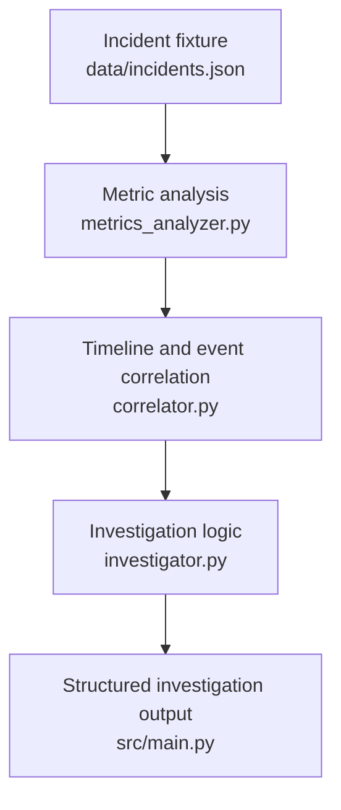
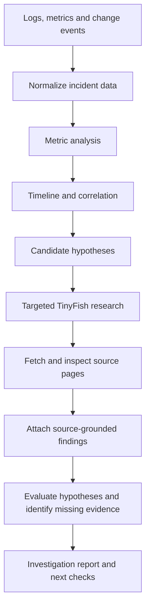

<div align="center">

# TRACE
### AI Incident Investigator

**From scattered incident signals to evidence-backed root-cause hypotheses.**

TRACE is a prototype investigation workflow that analyzes incident data, connects related events, and brings technical context into one structured investigation report.

<br/>

**AZINHACK ’26 · Project submission · 18 October 2026**

</div>

---

## The problem

When a production service fails, the clues are rarely in one place.

- **Logs** show errors, but not necessarily the underlying cause.
- **Metrics** reveal unusual behavior, but anomalies can have multiple explanations.
- **Deployment and configuration events** provide context, but timing alone does not prove causation.
- **Technical documentation and issue reports** can help explain a failure, but a similar issue elsewhere is not proof that it caused this incident.

Engineers must connect these signals, evaluate competing explanations, and determine what to check next.

## Our approach

TRACE is designed to make that investigation more structured and inspectable.

| Stage | What it does |
|---|---|
| **Analyze** | Examine incident metrics and identify unusual behavior. |
| **Correlate** | Place relevant events on a timeline and identify relationships worth investigating. |
| **Research** | Use TinyFish to search for and fetch relevant external technical sources. |
| **Evaluate** | Compare candidate explanations against available evidence. |
| **Report** | Present observations, hypotheses, source context, uncertainty, and next diagnostic checks. |

> **Principle:** Separate observed facts from inferred causes. A useful investigation should show *why* a hypothesis is plausible and *what evidence is still missing*.

---

## How it works

### Current prototype



### Intended end-to-end workflow



The second diagram represents the **target workflow**, not a claim that every stage is already implemented. See the status table below.

---

## Example investigation: `INC-002`

The current project scenario concerns database connection acquisition timeouts.

A useful investigation may examine:

- Application logs containing connection timeout errors.
- Metric behavior around the incident window.
- Deployment or configuration events that occurred near the failure.
- Relevant documentation, release notes, or issue reports found through external research.

A deployment-related regression could be one candidate explanation—but it is not the only one. Connection-pool exhaustion, slow queries, database saturation, traffic changes, or configuration problems may also fit the symptoms.

A strong TRACE report should distinguish:

| Category | Example |
|---|---|
| **Observation** | Application logs report connection acquisition timeouts. |
| **Candidate hypothesis** | A recent change may have increased connection demand. |
| **Evidence still needed** | Connection-pool utilization, query latency, deployment diff, and before/after comparisons. |
| **Next diagnostic step** | Inspect connection-pool settings and compare relevant metrics before and after the change. |

This is an example of the investigation logic—not a claim that the deployment has been proven to be the root cause.

---

## Implementation status

This table is intentionally conservative. Update it after testing the exact commit being submitted.

| Component | Status |
|---|---|
| Static incident input (`data/incidents.json`) | Current development input |
| Python entry point (`src/main.py`) | Present in the current project workflow |
| Metric analysis (`metrics_analyzer.py`) | Prototype implementation; validate edge cases |
| Event correlation (`correlator.py`) | Prototype implementation; validate event ordering and relationships |
| Investigation logic (`investigator.py`) | Prototype; verify report contents against current output |
| TinyFish external research | Search workflow has been explored; confirm Search + Fetch works end-to-end before claiming full integration |
| LLM-based hypothesis generation or ranking | Do not mark complete until integrated and tested |
| FastAPI endpoint | Planned unless the endpoint exists and runs |
| React + Vite dashboard | Planned unless the UI exists and runs |
| Docker packaging | Planned unless a clean container run has been tested |
| Live telemetry / OpenTelemetry | Future extension unless live ingestion is working |

**Submission rule:** The README, presentation, demo, and repository must describe the same implementation. Move a feature into “implemented” only when you can demonstrate it working.

---

## Repository layout

The core files currently used in the project are:
```text
.
├── data/
│   └── incidents.json
└── src/
    ├── main.py
    ├── metrics_analyzer.py
    ├── correlator.py
    ├── investigator.py
    └── web_research.py
```

The repository may contain additional files. Keep this tree synchronized with the actual checkout; do not list planned modules as though they already exist.

---

## Run the prototype

Run from the **repository root**.

### 1. Clone the repository

Replace the placeholder with your actual GitHub repository URL:

```bash
git clone <YOUR_REPOSITORY_URL>
cd <YOUR_REPOSITORY_DIRECTORY>
```

### 2. Create a virtual environment

**macOS / Linux**

```bash
python3 -m venv .venv
source .venv/bin/activate
```

**Windows PowerShell**

```powershell
py -m venv .venv
.venv\Scripts\Activate.ps1
```

### 3. Install dependencies

If the repository includes a maintained `requirements.txt`:

```bash
python -m pip install -r requirements.txt
```

If it does not, add and test a dependency file before submission. Do not install packages blindly; use the dependencies required by the code.

### 4. Run the current entry point

```bash
python3 src/main.py
```

On Windows, use `python src/main.py` if that is the Python command configured on your system.

**Verify these commands from a clean environment before submission.** If the actual entry point, setup process, or dependencies differ, update this section to match the tested procedure.

---

## TinyFish: external research

The intended role of TinyFish is to extend the investigation with relevant external technical context—not to make the root-cause decision by itself.

The research flow should:

1. Build a targeted query from the incident error, component, version, and relevant context.
2. Search for candidate documentation, release notes, or issue pages.
3. Fetch promising pages and inspect their contents.
4. Preserve source URLs and relevant excerpts.
5. Explain whether each source supports, contradicts, or merely contextualizes a hypothesis.
6. Handle empty results, failed fetches, irrelevant pages, and API errors.

A search-result title or snippet is not enough to establish a technical claim. The report should make it possible to inspect the source behind an external finding.

Before publishing, add a real example from the working integration: the query, a fetched source URL, a relevant excerpt, and how it affected the investigation. Do not include API keys, private tokens, or sensitive incident data.

---

## Reliability and evaluation

TRACE should be judged on the quality of its investigation trail—not on how confident its final wording sounds.

Before submission, test the following:

- [ ] The sample incident loads from a clean checkout.
- [ ] Timestamps are parsed and events are ordered consistently.
- [ ] Missing values and insufficient metric samples are handled explicitly.
- [ ] Anomaly output includes the relevant metric, timestamp, baseline, and observed value when available.
- [ ] Correlation does not get described as proof of causation.
- [ ] Hypotheses are connected to specific evidence and useful verification steps.
- [ ] External findings preserve source URLs and are based on fetched source content.
- [ ] Empty search results and failed requests do not crash the investigation.
- [ ] Re-running the same input produces reproducible output.
- [ ] The demo works using the documented setup commands.

If a metric has too few samples, the system should report **insufficient data** rather than silently treating it as normal.

---

## Limitations

- **Static fixtures are not live production telemetry.** They make development and demos reproducible, but do not establish real-world performance.
- **Correlation is not causation.** Events occurring close together can be unrelated.
- **External sources can mislead.** A similar issue in a release note or forum may not explain the current incident.
- **AI-generated hypotheses can be wrong.** Candidate explanations require evidence and verification.
- **Confidence needs a basis.** Do not present a ranking as a calibrated probability unless it has been evaluated as one.

TRACE is intended to support engineers by organizing evidence and proposing checks, not to replace incident-response judgment.

---

## Roadmap

Prioritize a working end-to-end investigation over a large set of disconnected features.

1. **Stabilize the core** — improve input validation, metric edge cases, correlation, and reproducible reports.
2. **Complete external research** — connect TinyFish Search + Fetch and retain source-grounded evidence.
3. **Improve hypothesis evaluation** — compare alternatives and identify missing or contradictory evidence.
4. **Add LLM reasoning** — use structured outputs and ground explanations in available evidence.
5. **Expose an API** — add FastAPI once the investigation engine has a stable interface.
6. **Build the dashboard** — use React + Vite to display the timeline, evidence, and candidate causes.
7. **Support live operation** — add telemetry ingestion and Docker packaging after the core workflow is reliable.

The order can change to meet the hackathon deadline. Each item should be marked complete only after it runs and can be demonstrated.

---

## Team and links

- **Team:** `[Team Name]`
- **Members and contributions:** `[Names — contribution for each member]`
- **Institution:** `[College / University]`
- **GitHub:** `[Repository URL]`
- **Demo:** `[Demo URL, if available]`

---

## Security

- Keep API keys and tokens in environment variables or a local `.env` file.
- Add `.env` and other secret-bearing files to `.gitignore`.
- Never commit credentials, private telemetry, or sensitive production logs.
- Use sanitized incident fixtures for public demos.

---

<div align="center">

**TRACE — make the investigation inspectable.**

*AZINHACK ’26 · 18 October 2026*

</div>
