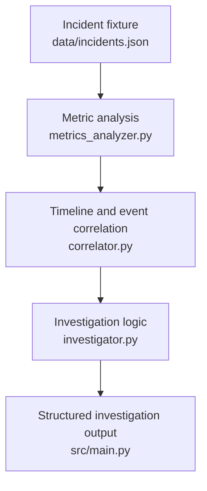

<div align="center">

# TRACE
### AI Incident Investigator

**From scattered incident signals to evidence-backed root-cause hypotheses.**

The current TRACE is a prototype investigation workflow that analyzes incident data, connects related events, and brings technical context into one structured investigation report.

</div>

---

## The problem

When a production service fails, the clues are rarely in one place.

- **Logs** show errors, but not necessarily the underlying cause.
- **Metrics** reveal unusual behavior, but anomalies can have multiple explanations.
- **Deployment and configuration events** provide context, but timing alone does not prove causation.
- **Technical documentation and issue reports** can help explain a failure, but a similar issue elsewhere is not proof that it caused this incident.

Engineers must connect these signals, evaluate competing explanations, and determine what to check next.

## Our approach

TRACE is designed to make that investigation more structured and inspectable.

| Stage | What it does |
|---|---|
| **Analyze** | Examine incident metrics and identify unusual behavior. |
| **Correlate** | Place relevant events on a timeline and identify relationships worth investigating. |
| **Research** | Use TinyFish to search for and fetch relevant external technical sources. |
| **Evaluate** | Compare candidate explanations against available evidence. |
| **Report** | Present observations, hypotheses, source context, uncertainty, and next diagnostic checks. |

> **Principle:** Separate observed facts from inferred causes. A useful investigation should show *why* a hypothesis is plausible and *what evidence is still missing*.

---

## How it works

### Current prototype



---

## Example investigation: `INC-002`

The current project scenario concerns database connection acquisition timeouts.

A useful investigation may examine:

- Application logs containing connection timeout errors.
- Metric behavior around the incident window.
- Deployment or configuration events that occurred near the failure.
- Relevant documentation, release notes, or issue reports found through external research.

A deployment-related regression could be one candidate explanation—but it is not the only one. Connection-pool exhaustion, slow queries, database saturation, traffic changes, or configuration problems may also fit the symptoms.

A strong TRACE report should distinguish:

| Category | Example |
|---|---|
| **Observation** | Application logs report connection acquisition timeouts. |
| **Candidate hypothesis** | A recent change may have increased connection demand. |
| **Evidence still needed** | Connection-pool utilization, query latency, deployment diff, and before/after comparisons. |
| **Next diagnostic step** | Inspect connection-pool settings and compare relevant metrics before and after the change. |

This is an example of the investigation logic—not a claim that the deployment has been proven to be the root cause.

---

## Repository layout

The core files currently used in the project are:

```text
.
├── data/
│   └── incidents.json
└── src/
    ├── main.py
    ├── metrics_analyzer.py
    ├── correlator.py
    └── investigator.py
```

The repository may contain additional files. Keep this tree synchronized with the actual checkout; do not list planned modules as though they already exist.

---

## Run the prototype

Run from the **repository root**.

### 1. Clone the repository

Replace the placeholder with your actual GitHub repository URL:

```bash
git clone <YOUR_REPOSITORY_URL>
cd <YOUR_REPOSITORY_DIRECTORY>
```

### 2. Create a virtual environment

**macOS / Linux**

```bash
python3 -m venv .venv
source .venv/bin/activate
```

**Windows PowerShell**

```powershell
py -m venv .venv
.venv\Scripts\Activate.ps1
```

### 3. Install dependencies

If the repository includes a maintained `requirements.txt`:

```bash
python -m pip install -r requirements.txt
```

If it does not, add and test a dependency file before submission. Do not install packages blindly; use the dependencies required by the code.

### 4. Run the current entry point

```bash
python3 src/main.py
```

On Windows, use `python src/main.py` if that is the Python command configured on your system.

**Verify these commands from a clean environment before submission.** If the actual entry point, setup process, or dependencies differ, update this section to match the tested procedure.

---

## TinyFish: external research

The intended role of TinyFish is to extend the investigation with relevant external technical context—not to make the root-cause decision by itself.

The research flow should:

1. Build a targeted query from the incident error, component, version, and relevant context.
2. Search for candidate documentation, release notes, or issue pages.
3. Fetch promising pages and inspect their contents.
4. Preserve source URLs and relevant excerpts.
5. Explain whether each source supports, contradicts, or merely contextualizes a hypothesis.
6. Handle empty results, failed fetches, irrelevant pages, and API errors.

A search-result title or snippet is not enough to establish a technical claim. The report should make it possible to inspect the source behind an external finding.

Before publishing, add a real example from the working integration: the query, a fetched source URL, a relevant excerpt, and how it affected the investigation. Do not include API keys, private tokens, or sensitive incident data.

---

## Current Limitations

- **Static input:** Incident data is provided through a JSON file; live telemetry ingestion is not implemented.
- **Basic anomaly detection:** Metric detection uses a simple threshold rather than a statistical or learned baseline.
- **Predefined hypotheses:** Hypotheses and scoring rules are predefined rather than generated through LLM reasoning.
- **Scores are not probabilities:** Hypothesis scores indicate relative ranking and should not be interpreted as calibrated probabilities.
- **Correlation is not causation:** An event occurring near a deployment does not prove that the deployment caused the incident.
- **Separate external research:** TinyFish research results do not currently affect the hypothesis ranking.
- **Preliminary findings:** Hypotheses are investigative leads that require verification, not confirmed root causes.
- **No frontend dashboard:** The current prototype does not include a frontend dashboard.

---

## Security

- Keep API keys and tokens in environment variables or a local `.env` file.
- Add `.env` and other secret-bearing files to `.gitignore`.
- Never commit credentials, private telemetry, or sensitive production logs.
- Use sanitized incident fixtures for public demos.

---

<div align="center">

**TRACE — make the investigation inspectable.**

</div>
